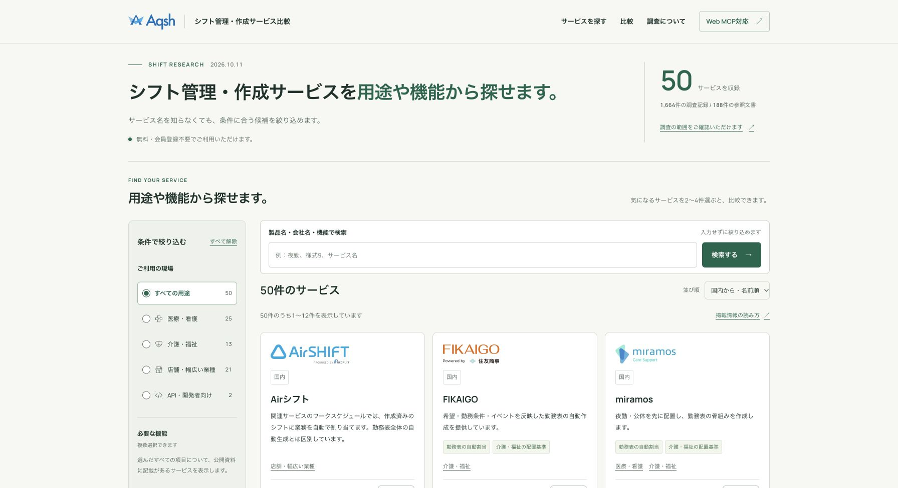
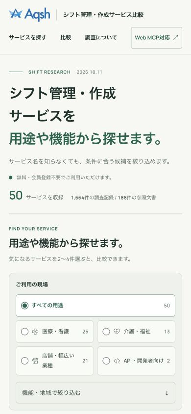

# 「シフト管理・作成」への表記変更

2026年10月12日、サイト名を「Aqsh シフト管理・作成サービス比較」へ変更しました。公開先は [shift.aqsh.co.jp](https://shift.aqsh.co.jp/) です。

TOPのタイトル・H1・説明文、ヘッダーとフッター、サービス一覧と比較ページのタイトル、医療・看護／介護・福祉／店舗の用途別ガイドのタイトル・説明文を揃えました。共通のサイト名を使う全ページのtitle末尾、OGP、Twitterカード、WebSiteの構造化データも更新しています。運営会社・利用規約・プライバシーポリシー・Web MCP案内内の名称、GA4のページ名の既定値、`llms.txt`、READMEも新名称へ変更しました。

スマートフォンのTOPでは「サービス」が途中で切れないよう、「サービスを」を一まとまりで折り返すようにしています。製品名・出典・調査データ・URLは保持し、調査基準日は2026年10月11日のままです。過去の改修報告は当時の記録として残しています。

本番Workerの公開版は`1b1eff49-ad6a-4cb8-bf82-921514968afb`、検証環境の最終版は`1157e2d0-def2-4914-9517-38bda501b597`です。対象のWorker・環境・D1 IDを照合してから公開しました。

- [公開62ページのSEO検査](branding-seo-verification-20261012.json)：全タイトルで新名称を確認。200応答、H1が1つ、正規URL、index指定、OGP・Twitterタグ、JSON-LD、タイトル・説明文の重複などに問題0件。
- [本番のメタデータ確認](branding-metadata-verification-20261012.json)：TOPのH1・title・description・OGP・Twitterタイトル・WebSite名と、`llms.txt`の新名称を確認。
- [本番の画面品質検証](branding-production-verification-20261012.json)：6件成功。320／390／768／1440px、WCAG AAの自動検査、検索後の戻る操作、D1取得回数、比較欄とアクセス解析の同意UIを確認。
- Astro診断：55ファイル、エラー・警告・ヒント0。本番ビルドと公開が成功しています。

これらはサイト側の反映確認です。Google検索結果の表示更新は、Googleによる再取得後に反映されます。今回、インデックス登録状況の再確認やGoogleへの登録依頼は行っていません。

`llms.txt`はSEO検査用User-Agentで200応答を確認しました。Python標準のUser-Agentでは403応答だったため、すべてのクローラーから取得できることを確認したものではありません。

