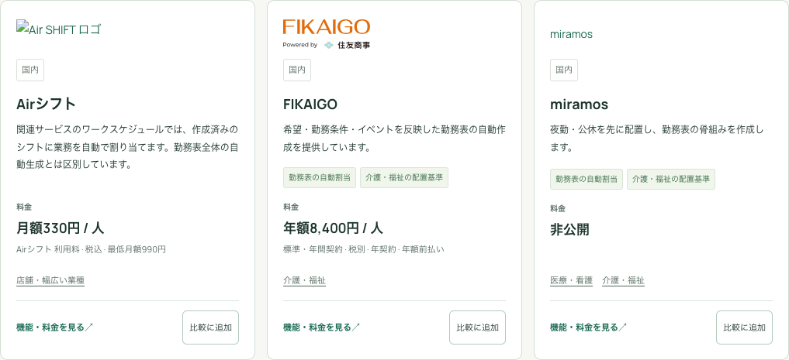

# 概要カードへの料金表示

2026年10月12日。TOP、サービス一覧、用途別ページで共用する概要カードに料金欄を追加した。金額が確認できる場合は通貨・課金単位・周期を表示し、未判明のものは「非公開」または「個別見積もり」とする。

## 表示条件

現在の掲載に採用した料金記録から、通常の継続料金を選ぶ。初期費用だけの0円、有料トライアル、追加オプション、過去・補足・不一致の料金を通常料金として使用しない。月払いが公開されている場合は月払いを優先し、年額や年契約の月額換算は条件を添える。通貨の換算は行わない。

Naftyの部署基本料と人数課金は同じプランの必須費用として両方表示する。ほすぴタッチの初期費用なども注記する。金額を確定できない場合や、公開資料の適用条件に不一致がある場合は、数字を推測せず「個別見積もり」とする。

| カードの例 | 表示 |
| --- | --- |
| Airシフト | 月額330円 / 人。税込、最低月額990円。 |
| FIKAIGO | 年額8,400円 / 人。税別、年契約・年額前払い。 |
| miramos | 非公開。 |
| Nafty | 月額5,000円 / 部署 ＋ 500円 / 人。Standardの基本料金。 |
| エピタルHR | 個別見積もり。 |
| シフト屋さん | 無料プランあり。1プロジェクト6人まで。 |

AirシフトとFIKAIGOの表示は、実装時にも [Airシフト公式料金](https://airregi.jp/shift/cost/) と [FIKAIGO公式料金](https://www.fikaigo.com/pricing) で確認した。カードの全料金・出典・追加条件は従来の詳細ページから確認できる。

## データの取得

カードの価格概要は、公開中のスナップショットの詳細JSONからサーバー側で作る。原本の価格明細は変更せず、D1の登録・切替も行わない。検索APIには同じ `price_summary` を追加する。カードごとの追加通信はなく、TOPのD1取得は1回のbatch・2クエリを維持する。

今回の公開データは `B07-20261011-pub2`。前の調査でローカルに追加したB08・B09の本番反映とは別の表示変更である。既存データとの互換性を保つため、新しい公開テーブルやカラムは追加しない。

## 検証

- Node.js 24.19.0で20件の回帰テストを確認。50件の価格概要、人数課金との合算、初期費用、未判明価格の表示、公開版切替中の一貫性を含む。
- Astroの検査は57ファイル、エラー・警告・ヒント各0件。
- 検証環境の5ブラウザテストで、SSR、絞り込み、比較選択、JavaScriptなしの表示を確認。
- 料金欄の高さ調整後、2ブラウザテストで320・390・1440px幅、横はみ出し、WCAG AAの自動検査、絞り込み後の料金表示を確認。
- 検証環境の50件は、料金額表示15件、無料・無料β2件、個別見積もり12件、非公開21件。

検証記録は [最初のブラウザ検証](card-pricing-staging-verification-20261012.json)、[最終表示の検証](card-pricing-staging-final-verification-20261012.json)、[検証環境の50件](card-pricing-staging-data-20261012.json)。ローカルB09の表示確認データは [ローカルの50件](card-pricing-local-data-20261012.json) に保存した。

## 公開

検証環境の最終Worker版は `01782f5e-2bc6-47e0-9351-f3d7181f51c6`。本番は環境名・Worker名・D1 IDを照合する既存の公開コマンドでビルドし直し、Worker版 `419901d5-4d60-4013-85d3-b5ef4764115f` を公開した。

[本番サイト](https://shift.aqsh.co.jp/#services) でも5ブラウザテストが成功し、全50サービスの価格概要が検証環境と一致した。TOP・一覧・介護用途のSSR、320・390・1440px幅、横はみ出し、WCAG AAの自動検査、絞り込み、比較選択、JavaScriptなしの表示を確認した。記録は [本番ブラウザ検証](card-pricing-production-verification-20261012.json) と [本番の50件](card-pricing-production-data-20261012.json)。

