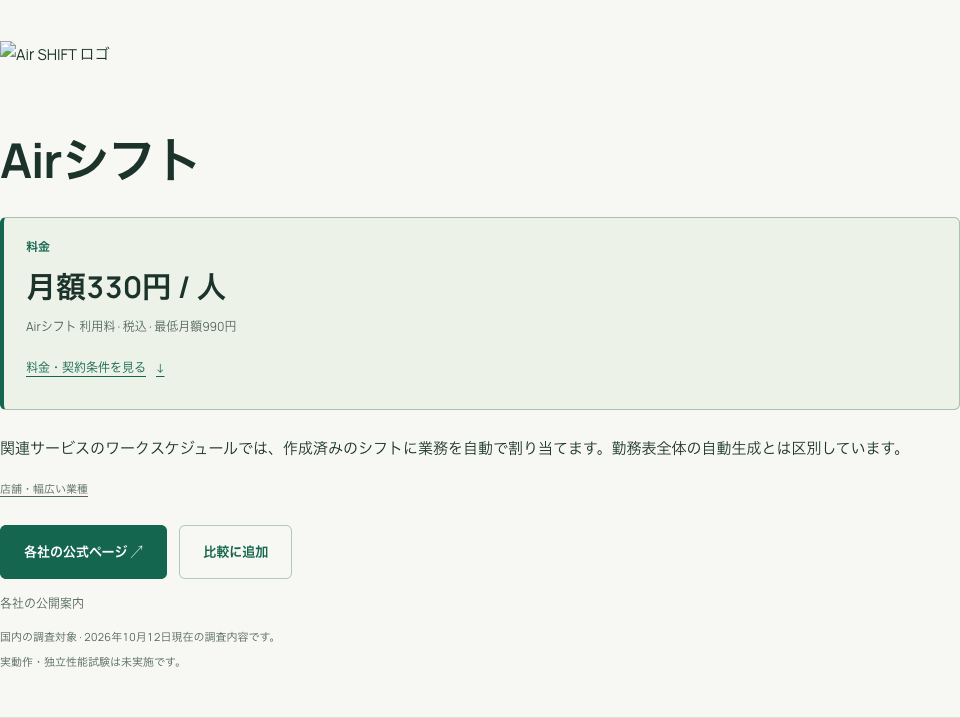
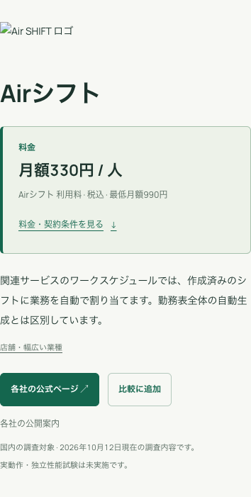

# 詳細ページの1カラム化

2026年10月12日。詳細ページはロゴ、サービス名、料金の順に縦に並べ、本文も1カラムに変更した。PC・スマートフォンで同じ順序を使用する。

ロゴを右側に置いていた枠を外し、ページ上部へ移した。提供法人名は料金欄の後に表示し、調査時点・確認範囲は導入文の下に置いた。本文横の「比較の前に」は、本文の後に同じ幅で配置する。見出し・本文・ページ内メニューは最大960pxの共通幅で揃える。

料金概要と契約条件、料金明細へのリンク、比較ボタン、機能・調査記録の内容は引き続き利用できる。公開中のデータは `B07-20261011-pub2`。今回の変更ではD1への書き込み・公開版の切替を行わない。

Astro検査は58ファイル、エラー・警告・ヒント各0件。検証環境・本番ともに3ブラウザテストが成功した。320・390・768・1440px幅で、ロゴ→サービス名→料金の配置順、本文と案内の幅、案内が本文の下にあること、横はみ出しがないこと、料金明細への移動、WCAG AAの自動検査を確認した。JavaScriptなしでのカードのロゴ・サービス名から詳細への移動、料金公開・無料・個別見積もり・非公開の表示も確認した。

検証環境のWorker版は `ee3f980c-f72c-4faa-86d6-05fa9139a2e4`。本番は対象Worker名・環境名・D1 IDを照合する既存コマンドでビルドし、Worker版 `a59290b4-1c48-43f9-bb5e-de42823da3fc` を公開した。

記録は [検証環境のブラウザ検証](detail-single-column-staging-verification-20261012.json)、[本番のブラウザ検証](detail-single-column-production-verification-20261012.json)、[検証概要とソースハッシュ](detail-single-column-verification-20261012.json)。以下の画像は本番で取得した。

