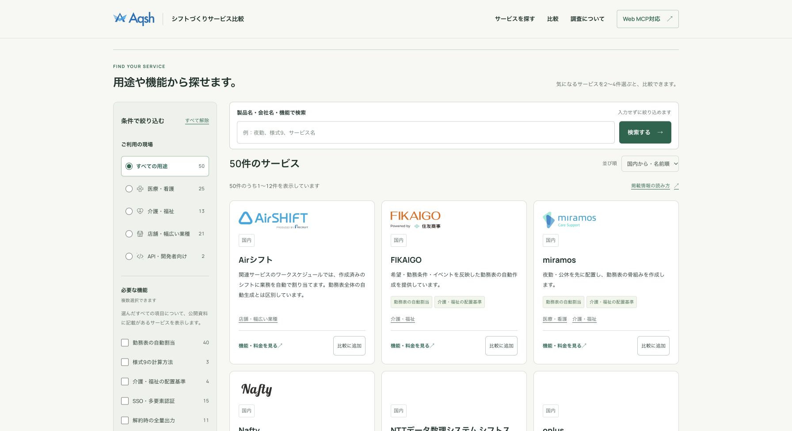
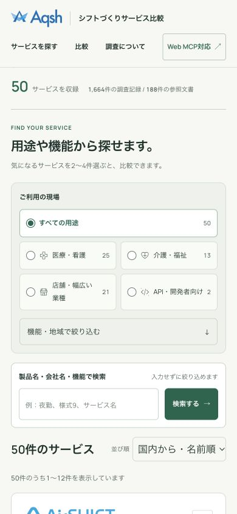
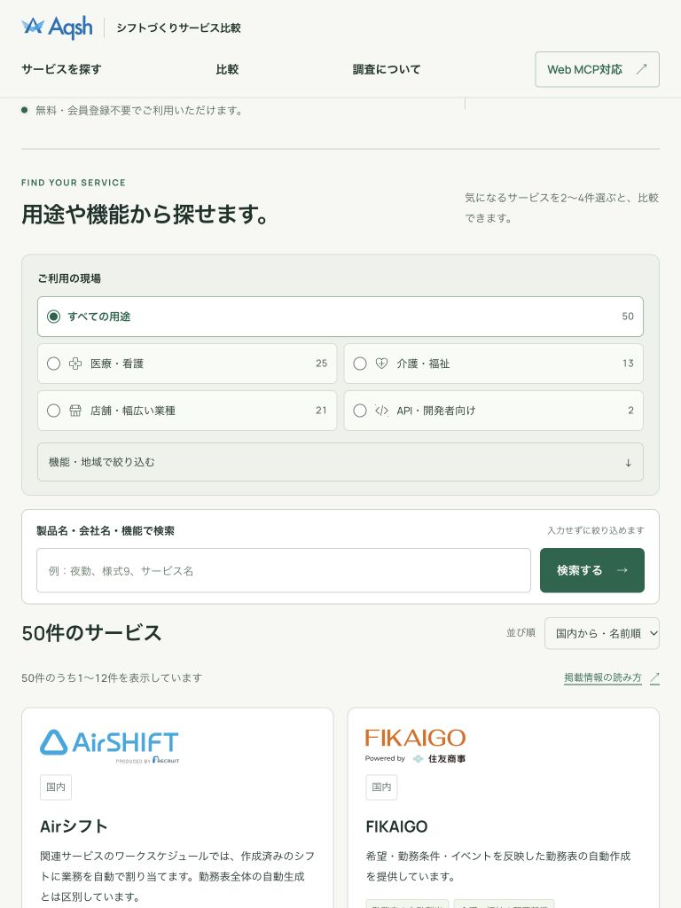

# TOPの絞り込み・サービス一覧の改善

サービス名・会社名を知らなくても探せるよう、TOPの中心を用途と機能の絞り込み、DBから取得したサービス一覧へ変更しました。公開先は [shift.aqsh.co.jp](https://shift.aqsh.co.jp/) です。調査基準日と公開版は2026年10月11日・`B07-20261011-pub2`のままです。

## 画面と操作

- 最初から50サービスのうち12件を表示します。ロゴ、サービス名、紹介文、公開資料で確認した項目、詳細へのリンクと「比較に追加」を掲載しています。5ページで全50件を閲覧できます。
- 医療・看護／介護・福祉／店舗・幅広い業種／API・開発者向けを選べます。国内・海外、勤務表の自動割当、様式9の計算方法、配置基準、SSO・多要素認証、解約時の全量出力を組み合わせられます。
- 機能はAND条件です。選んだすべての機能について`documented`の記録があるサービスを表示します。公開資料での記載は、すべてのプランでの利用や実機検証を意味しません。提供予定や記載未確認を確認済みとして扱いません。
- 候補件数は、他の選択条件を残して計算します。選択中の条件を一覧の上に表示し、個別解除・すべて解除・0件時の復帰を用意しています。並び順は国内から・名前順、または名前順です。おすすめ順位は付けていません。
- 名前の検索は任意です。用途・機能・地域の変更時は一覧を更新し、入力位置を維持します。ページ送りと検索送信時は結果へ移動します。比較選択は絞り込み・ページ送り・戻る操作でも維持します。
- スマートフォンでは用途を先に見せ、追加の機能・地域は必要なときに開けます。サービス詳細の機能表示は引き続き常時表示です。文字サイズ、タッチ操作の領域、横幅に応じたカード配置を調整しています。
- 用途別の選び方解説、調査方法、Web MCPの案内へのリンクを残しています。

## データ取得・SEO・計測

TOPはリクエスト単位の共有リポジトリから公開版と製品一覧を1回のD1 batch、2クエリで取得します。50件の軽量な一覧データで絞り込みと候補件数を計算し、HTMLへ描画するカードは最大12件です。D1のスキーマ、データ、公開版を変更していません。

JavaScriptの拡張時も同じGETのHTMLを取得し、結果・件数・選択条件を差し替えます。サーバーが部分HTMLを返す方式ではありません。GETフォームとページリンクはJavaScriptなしでも動作します。連続操作では古い取得を中断し、失敗時は以前の結果と対応する条件へ戻してエラーを表示します。ページ内移動だけではDBを再取得しません。

TOPの`CollectionPage`・`ItemList`は表示するサービスに合わせています。条件URLはnoindex、正規URLはTOPです。更新時はrobotsと一覧のJSON-LDも同期します。既存の製品詳細・用途ページ、公開読み取りAPI、Web MCPの5ツールの契約は維持しています。

GA4の同意設定と送信内容を維持し、一覧の更新成功時に既存の`catalog_search`を1回送ります。検索語・条件値・URLのクエリは計測へ送信しません。

LighthouseでFIKAIGOの外部ロゴがCookieを設定していることを確認したため、元のSVGを編集せず自己配信へ変更しました。APIの出典URLは保持し、完全一致する画像URLだけを表示時に置き換えます。[ロゴ出典記録](service-logo-assets.json)に取得日とハッシュを記録しています。

## 検証と公開

本番Workerは`aqsh-shift-research`、最終公開版は`982a2f3c-fae7-4cfe-a69c-f0e2fb0e499c`です。検証環境と本番それぞれでビルドし、生成設定のWorker名・環境名・D1 IDを照合して公開しました。

| 検証 | 結果 | 記録 |
| --- | --- | --- |
| Nodeの回帰検証 | 18件成功 | 入力、AND条件、ページ送り、原本保持、API契約、D1例外など |
| Astro診断 | 55ファイル、エラー・警告・ヒント0 | 最終コードで実行 |
| 本番の最終ブラウザ検証 | 10件成功、失敗・再試行による成功0 | [最終結果](home-directory-final-verification-20261011.json) |
| 本番の表示品質検証 | 15件成功 | [ロゴ配信調整前の結果](home-directory-production-verification-20261011.json) |
| 検証環境の機能・表示検査 | 18件、次の改修時15件成功 | [初回](home-directory-staging-verification-20261011.json)、[表示調整後](home-directory-staging-final-verification-20261011.json) |

最終ブラウザ検証はDBとの全50件照合、1回のD1呼出、複数条件、解除、比較、履歴復元、JavaScriptなし、通信失敗・古い応答の中断、320／390／768／1440px、WCAG AAの自動検査、ロゴの取得、Web MCPの登録・実行・取消を対象にしています。先行の品質検査には詳細・比較の表示、同意UIとGoogle通信の制御も含みます。

本番TOPをモバイル条件で1回測定したLighthouse 13.5.0の結果は、性能99、アクセシビリティ100、ベストプラクティス100、SEO100でした。FCP 1.4秒、LCP 1.8秒、CLS 0.012、TBT 0msです。[条件・測定値](home-directory-lighthouse-20261011.json)に環境を記録しています。実利用者のCore Web VitalsやGoogleの掲載順位・インデックス登録を示すものではありません。外部画像のキャッシュ、画像転送量、描画を妨げる通信などの改善余地は残ります。

ブラウザ内のWeb MCPテストは、独立したAIによる自然言語でのツール選択評価を代替しません。自動アクセシビリティ検査も全支援技術での手動試験を代替しません。

## 本番画面

PCの一覧、390pxのスマートフォン、768pxのタブレットを保存しました。キャプチャ後はブラウザの一時的な表示幅指定を解除しています。

