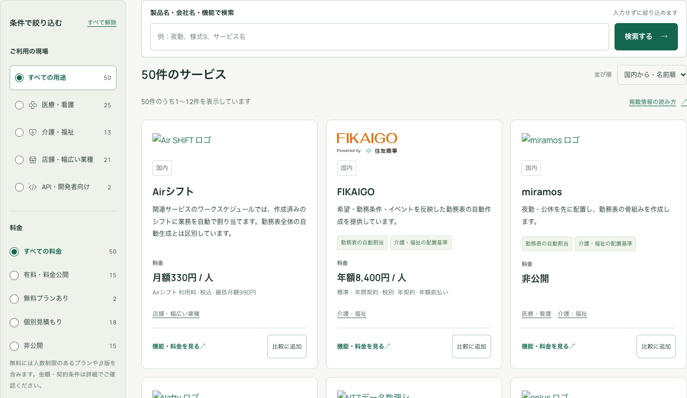
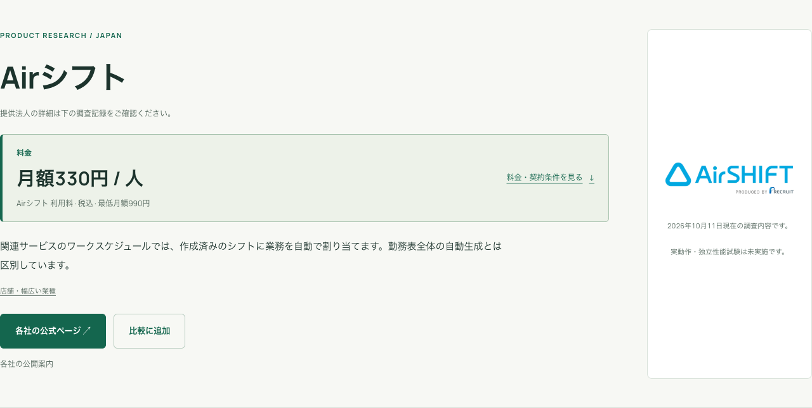

# 料金フィルターと詳細ページへの導線

2026年10月12日。TOPの「条件で絞り込む」に料金を追加し、概要カードのロゴとサービス名から詳細ページへ移動できるようにした。詳細ページでは、サービス名のすぐ下に料金概要・課金条件・料金明細へのリンクを表示する。

## 絞り込み

| 料金の区分 | URLの条件 | 公開中の件数 |
| --- | --- | ---: |
| すべての料金 | 条件なし | 50 |
| 有料・料金公開 | `price=published` | 15 |
| 無料プランあり | `price=free` | 2 |
| 個別見積もり | `price=quote` | 12 |
| 非公開 | `price=unpublished` | 21 |

区分は既存の `price_summary.kind` を使う。無料には人数制限のある無料プランと無料β版を含む。金額の通貨・周期・課金単位を換算して大小比較する機能は追加していない。

用途・地域・必要な機能と同時に指定できる。各選択肢の件数は、他の条件を維持して算出する。URL、ページ送り、選択中の条件の解除、ブラウザの戻る操作にも料金を引き継ぐ。スマートフォンの追加条件ボタンと選択数にも料金を含める。JavaScriptなしではGETフォームの「検索する」で適用する。

## カードと詳細

カードの共通コンポーネントを更新したため、TOP・サービス一覧・用途別ページのロゴからも詳細を開ける。サービス名の既存リンクも維持し、比較ボタンは独立した操作として使える。ロゴにはサービス名を含むリンク名とキーボードフォーカスを付けた。

詳細上部の料金欄はカードと同じ生成関数を使用する。税込・税別、最低月額、年契約、人数・部署単位などの注記も表示する。「料金・契約条件を見る」から既存の明細へ移動できる。未判明のものは「非公開」または「個別見積もり」とする。

## 検証と公開

- Node.jsの回帰テスト22件が成功。料金区分、複合条件、件数、URL、ページ送り、入力検証を含む。
- Astro検査は58ファイル、エラー・警告・ヒント各0件。
- 検証環境のブラウザテスト12件が成功。料金区分の全50サービス、複合条件、履歴、比較選択、JavaScriptなし、ロゴと名前の遷移、詳細の料金と条件を確認した。
- 320・390・768・1440px幅で横はみ出しがなく、料金欄は詳細上部に表示された。TOP・詳細のWCAG AA自動検査で違反0件。

検証環境のWorker版は `81ddd5d2-ccb3-484e-855e-f32967c4d6bb`。本番は対象のWorker名・環境名・D1 IDを照合する既存の公開コマンドでビルドし、Worker版 `55f6ab99-2eed-45c7-9e83-887ba2f75b4f` を反映した。

[本番サイト](https://shift.aqsh.co.jp/#services) の5ブラウザテストも成功した。全50サービスの料金区分とページ送り、複合条件、履歴、比較選択、JavaScriptなし、ロゴと名前の遷移、詳細上部の料金・契約条件、320・390・768・1440px幅、WCAG AA自動検査を確認した。

記録は [検証環境のブラウザ検証](pricing-navigation-staging-verification-20261012.json)、[本番のブラウザ検証](pricing-navigation-production-verification-20261012.json)、[検証概要とソースハッシュ](pricing-navigation-verification-20261012.json)。以下の画像は本番で取得した。

画面記録の取得時はテスト用ブラウザでアクセス解析への同意を断り、追加の表示確認1件も成功した。PC画像は料金の選択肢全体が入る撮影用の高さで保存した。

掲載データは `B07-20261011-pub2` のまま。この表示変更ではD1の書き込み・公開版の切替を行わない。TOPのD1取得は1回のbatch・2クエリを維持する。
