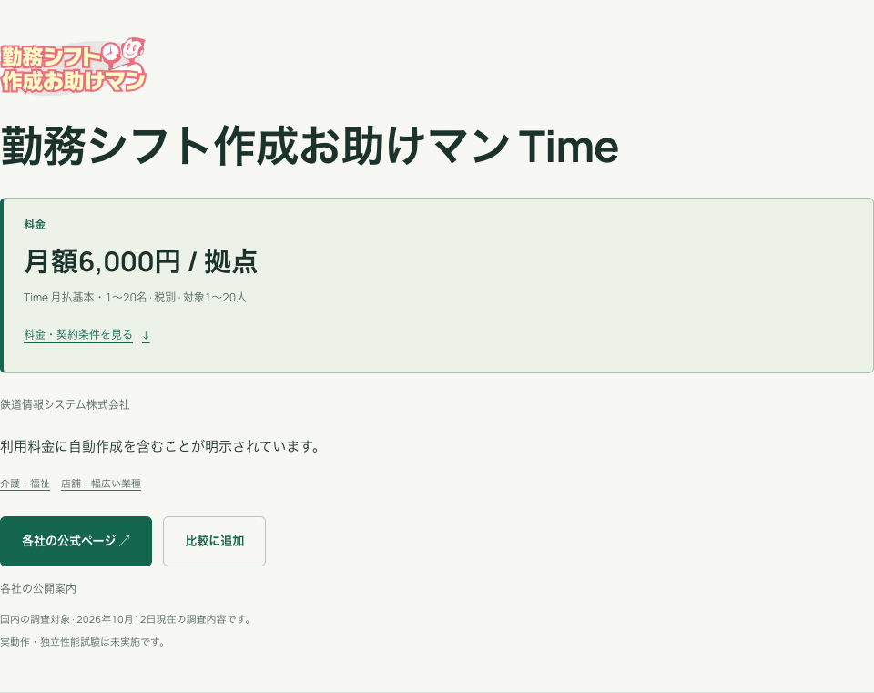
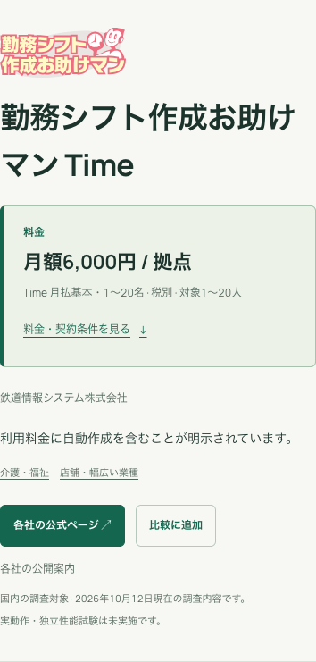

# 第12バッチまでの本番反映

2026年10月12日、未公開だった第8〜12バッチを [本番サイト](https://shift.aqsh.co.jp/) に反映しました。公開版は `B12-20261012-pub2`。199件の調査記録、24件の料金明細、分類訂正1件を追加し、調査日も公開データから表示するよう更新しました。

| 公開範囲 | 更新前 | 更新後 |
|---|---:|---:|
| 掲載サービス | 50 | 50 |
| 文書による調査記録 | 1,664 | 1,863 |
| 調査文書 | 188 | 230 |
| 料金明細 | 88 | 112 |
| 優先度1の未完了課題 | 30 | 29 |
| 調査基準日 | 2026-10-11 | 2026-10-12 |

料金カード、料金の絞り込み、ロゴ・サービス名からの詳細への移動、詳細上部の料金は最新データを使用しています。詳細ページはPC・スマートフォンともに1カラムで、ロゴ→サービス名→料金の順です。お助けマンTimeの料金概要は、1〜20名の月払い基本料「月額6,000円 / 拠点・税別」に更新されました。Dayは月額12,000円 / 拠点・税別、勤夢表VXは条件付きの参考構成額を一般価格に使わず「個別見積もり」を維持しています。

検索API・詳細・一覧・用途別一覧・調査方法・AI向け取得結果の基準日は公開版のデータに追従します。用途別解説の編集日や制度資料の確認日は、元の確認日を保持しています。

## 更新と検証

本番・検証D1を全件エクスポートし、反映前の版を確認してから差分SQLを生成しました。初回登録用のimport.sqlは再投入していません。新しい調査行、課題進捗、最新評価、公開用データ、公開版の切替を1回のD1ファイルインポートに含めました。版・件数・変更前の値が異なると停止します。検証時に確認処理がD1の式の深さ制限に当たったため、小さい確認処理へ分割し、取り消しを含む回帰テストを追加しました。

検証環境への反映と全件照合を先に完了し、本番を公開しました。更新前の調査行と過去の公開版は保持しています。更新後のD1エクスポートでも、過去のweb_snapshots・web_products・web_categoriesの全行が残っていることを確認しました。

- Astro：58ファイル、エラー・警告・ヒント各0件。Nodeの22テスト、公開投影4テスト、差分更新7テストが成功。
- 本番・検証D1：全39調査テーブルが正本と一致。外部キー違反0件、整合性検査ok。
- 本番・検証API：調査範囲と50サービスすべての料金概要が一致。代表6サービスの料金明細・提供条件・課題・評価を照合。
- 検証環境：32項目を確認。旧データの固定件数・旧記録構成を前提とする2テストを更新し、該当2件の再検査も成功。
- 本番：32ブラウザテストが全件成功。検索、条件の組合せ、ページ送り、履歴、比較、JavaScriptなしの操作、Web MCP5ツール、WCAG AAの自動検査、320・390・768・1440pxを確認。
- 公開62ページ：HTTP応答、正規URL、固有のタイトル・説明文、構造化データ等の検査で問題0件。

研究SHA-256は `9d407025bc45dc5d1f5753b282da1eda188d988844618092566641e46f2e6409`、公開内容SHA-256は `975ec80e4b3bdff8b2fa86b92b468818191892f50ad57b15b361325a67ca29ce`。更新SQLは1,587文で、SHA-256は `0b31e9e41622ad73c083c2b3dea9e83631fede29ee9faebb998eba4e7497c0cf` です。

## 公開版と復旧情報

本番Workerは `a0c0f88c-0fca-405e-84b1-50db44913cf7`、検証Workerは `d8c0ec58-63b7-459b-b4b9-50b4dd1b5284`。本番の旧Worker版は `a59290b4-1c48-43f9-bb5e-de42823da3fc`、旧公開データ版は `B07-20261011-pub2` です。

本番D1の更新前Time Travel bookmarkは `00000074-00000000-00005102-7f87752aab6c60e9c34424e1a65d7247`。更新前のSQLはこの実行環境の `/private/tmp/shift-production-before-b12.sql` と `/private/tmp/shift-staging-before-b12.sql` に保存しました。一時ファイルは永続バックアップではありません。復旧時は保管した公開版、CloudflareのWorker版・Time Travelを使用します。公開版だけを戻す場合、研究履歴APIは新しい調査記録を引き続き含みます。

根拠は [公開検証概要](research-b12-publication-verification-20261012.json)、[本番D1照合](research-b12-production-d1-verification-20261012.json)、[本番API照合](research-b12-production-api-verification-20261012.json)、[本番画面検証](research-b12-production-browser-verification-20261012.json)、[公開62ページ検査](research-b12-production-seo-verification-20261012.json)、[過去公開版の保持](research-b12-publication-preservation-20261012.json)。研究作成時点の第8〜12バッチ検証JSONは歴史的な状態を保持し、この公開記録を最新の反映状況とします。

資料で確認した範囲を公開しており、製品の独立した実動作・性能試験は未実施です。見積や契約資料、実機確認を要する研究課題は継続します。

