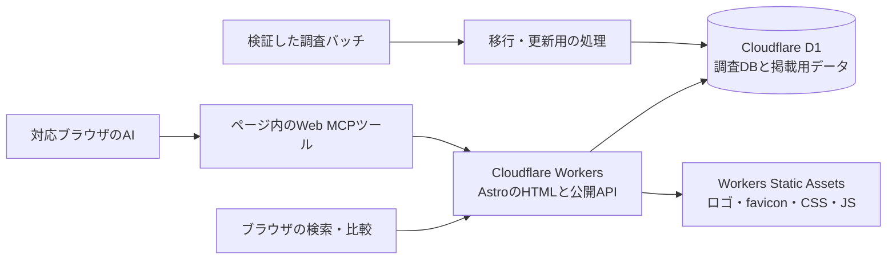

# Aqsh シフト比較 — 調査継続・Webアプリ開発・公開計画

計画日：2026年10月11日。以下は承認時点の計画。実装・追加調査・D1登録・検証を進めた結果は [公開報告](deployment-20261011.md) に記録する。DNSがムームードメイン管理のため、配信入口にCloudflare Pagesを追加し、Workersへサービスバインディングで接続する。

サイト名は**Aqsh シフト比較**、公開先は**https://shift.aqsh.co.jp/**とする。公開URLはユーザー指定で確定した。無料・会員登録不要で、シフト管理・自動作成サービスの公開資料を検索し、提供範囲と出典を比較できるサイトを作る。

## 1. 調査の現在地と、公開までの進め方

調査は全機能の確認完了には至っていない。B06時点で50提供単位、1,627文書記録、180調査文書、88料金明細、ロゴ50件、制度参照17件がある。優先度1の未完了課題は30件。独立試験は14シナリオの設計があり、実施結果は0件。

30件の必要確認方法は、公開資料1、販売元資料16、デモ4、合成試験4、見積4、利用者等の独立一次資料1。未完了の広い設問をすべて公開の必須条件にすると、ログインや契約のない状態では終わりを定義できない。公開前の追加調査と、継続調査を分ける。

| 区分 | 実施内容 | 公開の扱い |
|---|---|---|
| 公開前に調べる | Nafty介護の提供時点、料金・プラン・提供版の不一致、対象製品の公式URL・公式ロゴ、提供予定の記載、採用根拠と誤分類の残存 | 新たに確認できた事実を次バッチへ追加。解消しないものは比較条件を限定し、未確定を表示 |
| 表示設計で対処する | 様式9の算式、管理者MFAの強制範囲、解約時全量出力など、部分確認・矛盾のある設問 | 「対応」と一括表示しない。確認できた条件、出典、調査日、未確認の範囲を併記 |
| 公開後も継続する | 現行の個別契約・見積、実Excelの数式検算、全量返却の再構成、管理者ロックアウト復旧、独立した性能・公平性試験 | 未検証として掲載。資料だけで課題を完了にせず、追加結果を別バッチで追記 |

公開前の調査終了条件は、50対象すべてに提供単位・公式リンク・確認状況があり、掲載する要約の出典と適用条件を追えること。誤分類を採用根拠へ戻さず、矛盾・旧版・予定・未知価格を表示上も区別できること。未確認が残る項目は、その範囲を確かめるための資料サイトとして公開する。

第7バッチ以降も調査基準日は2026-10-11として扱う。後日確認した内容は取得日をそのまま記録し、10月11日に確認したと偽らない。実際に基準日を更新する場合は、スナップショットと変更履歴を分ける。

## 2. ページと機能

| ページ | URL案 | 内容 |
|---|---|---|
| トップ | `/` | サイトの目的、検索、用途別入口、調査対象50件、調査基準日、確認状況の読み方 |
| 製品一覧 | `/products/` | 全50提供単位。検索、絞り込み、並び替え、比較への追加、公式リンク |
| 製品詳細 | `/products/{slug}/` | 名称・ロゴ・会社・版・地域・特徴・料金・機能・出典・未確認・更新履歴 |
| 比較 | `/compare/?products=...` | 2〜4提供単位を比較。共通40項目と、医療・認証・解約等の深掘り項目。違いの強調、条件表示、共有URL |
| 用途別一覧 | `/categories/{slug}/` | 医療、介護、汎用、API等。根拠のある対象分類と、その用途の選び方 |
| 調査方法 | `/methodology/` | 50対象の選定、資料確認と実動作の差、出典、状態表示、調査・更新履歴 |
| 様式9の参照 | `/references/form-9/` | 行政資料と専門団体手引きの17参照。算式・除外・丸め・留保・出典 |
| Web MCP案内 | `/webmcp/` | 利用できる操作、対応条件、通常閲覧との関係、確認できたブラウザ・AI・検証日 |
| 運営会社 | `/about/` | Aqsh株式会社、公式会社情報、連絡先、調査の目的、情報訂正の窓口 |
| プライバシー | `/privacy/` | このサイトで実際に扱うアクセスログ、ブラウザ内保存、外部サービス、問い合わせ情報 |
| 利用規約 | `/terms/` | 無料閲覧、情報の時点・範囲、外部リンク、商標・著作物、禁止行為、訂正・変更等 |

詳細ページは製品ごとに独立したURLとHTMLを持たせる。API・受託開発・手動支援等を、自動勤務表生成サービスと同じ提供範囲へまとめない。初期掲載は日本語を基本とし、海外製品にも日本語の調査要約を付ける。

### 一覧・検索・絞り込み

- 製品名、会社名、別名、日本語・英語表記、資料の要約で検索。全角半角や大文字小文字の差を正規化する。
- 国内／海外の調査区分、医療／介護／汎用／API等の分類、提供範囲、公開資料で確認した機能、確認状況で絞り込む。
- 機能フィルターは、設問と採用根拠へ関連付ける。「MFA」という語があるだけで管理者MFA必須と判定しない。予定・部分確認を含めるか選べるようにする。
- 名前順を基本にする。資料採用枠数を機能の優劣・品質ランキングとして使わない。
- 料金は通貨、地域、プラン、人数、支払周期、税、最低条件を表示。見積・旧参考値・不一致を分け、未知の金額を0円にしない。単純な安さ順は初期版で設けない。
- 0件時は条件の解除を案内。戻る操作、URLによる状態復元、モバイル操作、キーボード操作に対応する。

### 詳細・比較で伝えること

名称とロゴ、公式ページへのリンク、提供単位、調査基準日を上部に置く。料金・機能は「資料で確認」「一部確認」「提供予定」「記載未確認」「資料に不一致」「実動作未検証」を日本語で示し、確認した条件と出典へ辿れるようにする。DB内部のコード名は一般利用者の主な表示に使わない。

現在の採用根拠を本文の要約に使い、以前の記載・分類訂正・採用除外は履歴へ分ける。引用資料が実装を証明していない場合は、製品の対応済み表示に転換しない。特に様式9の原則式と各製品の実装結果を分ける。

比較は画面下部の選択欄から追加・解除でき、5件目は追加できないことを説明する。表は製品列、項目行で、モバイルでは横スクロールと見出し固定を使う。内容の条件・出典を省略して、丸・バツだけにしない。

## 3. 技術構成

**Astro + TypeScript + Cloudflare Workers + D1**を採用する案とする。本文をHTMLで返し、検索・比較等に必要な部分だけクライアントJavaScriptを使う。CloudflareとAstroの公式資料はWorkers上のHTML生成とD1等のbindingsを案内している。[CloudflareのAstroガイド](https://developers.cloudflare.com/workers/framework-guides/web-apps/astro/)、[Astro Cloudflare adapter](https://docs.astro.build/en/guides/integrations-guide/cloudflare/)。

同じGitHubリポジトリに`apps/web/`を追加し、調査パッケージを保持する。公開アプリはD1を読み、現在のcomparison.htmlはローカル検証用として残す。アプリには検索・比較・公開資料取得のAPIを用意するが、編集・インポート・任意SQLの実行を公開しない。初期版に会員、管理画面、投稿、AIチャットの課金APIは設けない。

CSS・画像等はWorkers Static Assetsで配信する。本文・APIはデータ版を含むキャッシュを使い、調査更新時に切り替える。未知の任意クエリを無限にキャッシュしない。API側でも検索語長、フィルター、並び順、件数、比較上限を検証し、固定したSQLへbindする。

依存バージョンは実装開始時の公式サポートを確認して固定する。最新Astro adapterでは以前の`Astro.locals.runtime`からの移行があるため、古いサンプルをそのまま使わない。Workersのcompatibility dateも明示する。

## 4. D1への移行と、掲載用データ

正本のv3.1・39テーブル・12ビューと、観測・出典・判断・訂正履歴を保持する。既存のd1/import.sqlは空のD1へ初回登録し、以降は追加バッチ・番号付きmigrationで更新する。既存D1へ全件SQLを重ねて適用しない。

本番・検証用D1を分ける。初回登録後に39テーブルの件数・全データ、共通40項目、優先ロゴ、17制度参照を照合する。既存のローカルD1検証結果と、遠隔での検証結果を区別する。

掲載用に以下を追加する。これは調査の原記録を上書きする処理ではない。

| データ | 用途 |
|---|---|
| 公開スナップショット | 調査基準日、掲載対象バッチ、公開日、データの版・ハッシュ |
| ページ情報 | offering_idに紐付くslug、見出し、編集した概要、公開状態、本文更新日 |
| 用途分類 | 分類名、説明、対象提供単位、分類の根拠 |
| 一覧・検索用索引 | 名称・別名・概要、採用した機能と確認状態。調査バッチから再生成可能にする |

検索時に1,627記録を毎回まとめて読み込まず、50提供単位の掲載用索引と必要な根拠を取得する。現在の規模では正規化済みテキストの部分一致から始め、読み取り行数を計測する。D1無料枠の消費は返却件数ではなく走査行数も関係する。[D1料金と行数の説明](https://developers.cloudflare.com/d1/platform/pricing/)。

slugは提供単位ごとに安定させ、製品名の変更だけでURLを変えない。変更する場合は301転送を記録する。公開APIは掲載対象の固定フィールドだけを返し、内部の課題所有者やログ・認証情報を返さない。更新は検証→バックアップ→移行→照合→掲載版の切替で行う。既存D1を初期化してやり直す運用にはしない。

## 5. Web MCPでAIへ渡す情報

2026-10-09のCommunity Group Draftと2026-10-07更新のChrome公式資料を確認した。API入口は`document.modelContext`。登録、ツール取得・実行、AbortSignalによる解除、annotations等を現在の仕様に合わせる。8月時点のローカル参照と異なり、現行DraftのIDLには`executeTool()`が含まれる。[現行Draft](https://webmachinelearning.github.io/webmcp/)、[Chrome命令的API](https://developer.chrome.com/docs/ai/webmcp/imperative-api)。

初期版は公開情報の取得を中心に5ツールへ絞る。

| ツール案 | 入力・結果 |
|---|---|
| `search_shift_products` | 検索語、分類、機能・確認状況、ページ送り。該当製品、公式URL、条件、調査日を返し、一覧にも反映 |
| `get_shift_product` | 提供単位ID。概要、版・地域・プラン、料金、機能、未確認、根拠を返して詳細領域へ表示 |
| `compare_shift_products` | 2〜4提供単位、比較する項目。条件付きの比較表、資料の不一致、参照先を返し画面にも反映 |
| `get_shift_evidence` | 製品・項目・ページ送り。観測の要約、原資料URL、取得日、該当箇所、採用・履歴の関係 |
| `get_research_scope` | 調査方法、基準日、確認状態の定義、実動作試験の未実施、制度参照の索引 |

全ツールの出力には、`data_as_of`、`dataset_version`、`offering_id`、提供範囲、確認状態、未確認理由、出典参照を含める。価格は通貨・税・支払周期・プラン・地域・金額状態を保持する。次のページを辿れるようにし、全DBを一度に長文で返さない。

JSON Schemaとサーバー検証を揃え、余分な引数・任意URL・任意SQLを受け付けない。出典本文は未信頼データとして区別し、読み取り専用のhintと`untrustedContentHint`を設定する。登録と実行のキャンセル、重複登録、画面遷移、APIエラーも検証する。

Web MCPは、サイトを開いた対応ブラウザ・AIへツールを提供する仕組みである。これだけで、すべての外部AIへ接続できる常設MCPサーバーになるとは扱わない。非対応環境では通常UIとHTML・公開APIが使える。[Chrome WebMCPの制限と発見方法](https://developer.chrome.com/docs/ai/webmcp)。

公開画面には「Web MCP対応」を明記し、試験運用の条件、確認できた環境、利用できる操作を案内する。登録確認だけでAIによる自然言語操作の合格とはしない。HTTPS、Permissions Policy、Origin Trialの現在の条件・期限・本番オリジン用トークンを公開前に確認する。公開用トークンの登録やブラウザ拡張への権限付与は、この計画段階では行わない。

## 6. Google検索対応

製品名を検索した人が、その製品の用途・料金条件・機能・根拠へ直接着地できる構成にする。主要本文・リンク・タイトル・canonicalを初回HTMLへ含める。[GoogleのJavaScript SEO](https://developers.google.com/search/docs/crawling-indexing/javascript/javascript-seo-basics)。

- 初期の検索入口は50詳細ページと製品一覧、根拠のある用途別ページ。製品名、シフト自動作成、医療・介護のシフト、様式9等をページ目的に合わせて自然に扱う。
- 各詳細に独自の概要、対象範囲、料金条件、確認できた機能、未確認事項、公式リンクと出典を置く。販売元の文章をコピーするだけのページにしない。
- 機能別の解説・用途別比較は、十分な資料と固有の説明があるものから編集する。全製品ペアの比較URLを自動的に量産・索引対象にしない。
- title、description、H1、canonical、OGP、favicon、画像alt、パンくず、内部リンク、sitemap.xml、robots.txt、404／301、HTTPS、圧縮・キャッシュを揃える。
- 検索結果、自由な絞り込み、任意比較は原則noindex。サイトマップは正規の掲載ページのみ。検索パラメータや並び替えで無限の索引候補を作らない。noindexを読ませるURLを同時にrobotsで遮断しない。増大する任意パラメータは内部リンクの制限や必要に応じたクロール制御を別に設計する。[GoogleのファセットURL管理](https://developers.google.com/crawling/docs/faceted-navigation)。
- 用途別の正規ページは独立した説明と対象を持たせる。無効なslug・存在しないページは本物の404を返す。検索0件は検索ページ内で説明する。
- Organization、WebSite、BreadcrumbList、一覧のCollectionPage／ItemList、本文の内容と一致するWebPage等を使う。電話番号をJSON-LDにも入れない。
- 製品のSoftwareApplication等は確認した事実だけを記載する。Rich Resultの条件を満たすために価格・評価・口コミを作らない。GoogleのSoftware App表示には価格と評価／レビュー等の条件があるが、この調査には実利用レビューの裏付けがない。[GoogleのSoftware App構造化データ](https://developers.google.com/search/docs/appearance/structured-data/software-app)。
- 「2026年10月11日現在の調査内容」を全詳細・比較・調査方法へ表示。実際のページ公開日・本文更新日と分け、sitemapのlastmodを毎回機械的に今日へ変えない。
- モバイル、キーボード、色以外の状態表示、フォーカス、表の見出しを確認する。性能はLCP 2.5秒以内、INP 200ms以内、CLS 0.1以内を目標にし、初期は実験室計測、公開後は実利用の75パーセンタイルの計測と区別する。LighthouseのTBTを実利用のINPと同じ測定結果にはしない。[GoogleのWeb Vitals](https://web.dev/articles/vitals)。
- 公開後はSearch Consoleで所有権確認、サイトマップ送信、代表URL検査、インデックス、検索クエリ・クリックを確認する。検索表示や順位を確約せず、実測で改善する。[Google Search Essentials](https://developers.google.com/search/docs/essentials)。

プレビューはnoindex。本番URLのcanonicalと一致させ、Cloudflareの別公開ホストを重複した検索対象にしない。llms.txtや構造化JSONはAI向けの補助として検討し、それ自体をGoogleでの順位向上の保証にしない。

## 7. Aqshのブランド・会社情報・規約

2026-10-11に[公式会社概要](https://aqsh.co.jp/company/)のライブ表示を確認した。以下を新サイトへ掲載する。

| 項目 | 確認した情報 |
|---|---|
| 運営会社 | Aqsh株式会社 / Aqsh Co. Ltd. |
| 代表者 | 代表取締役 塚田 崇博 |
| 設立 | 2021年4月1日 |
| 事業所 | 〒028-7111 岩手県八幡平市大更第２５地割 113番地 起業家支援センター2F |
| 盛岡オフィス | 〒020-0021 岩手県盛岡市中央通１丁目７−３５ コアフィールド モリオカ 1F |
| 連絡先 | info@aqsh.co.jp、公式問い合わせページへのリンク |
| 事業紹介 | 公式情報に基づくブランディング、マーケティング、HR、Web・アプリ開発、AI等の説明 |

電話番号は本文、会社概要、フッター、meta、JSON-LD、画像alt、問い合わせ案内に掲載しない。公式サイトのHTML全体を取り込まず、必要な会社情報と画像素材のみを利用する。

確認した公式素材：

- [AqshロゴPNG](https://aqsh.co.jp/wp-content/uploads/2024/01/a340bad26f3ec6fe1741a7ff1ad28ba6.png)：公式ページで1112×385の画像表示を確認。
- [favicon 32px](https://aqsh.co.jp/wp-content/uploads/2023/12/cropped-ddc33bb390c2cd276a4cb666abb5e36a-32x32.png)、[icon 192px](https://aqsh.co.jp/wp-content/uploads/2023/12/cropped-ddc33bb390c2cd276a4cb666abb5e36a-192x192.png)、[Apple touch icon 180px](https://aqsh.co.jp/wp-content/uploads/2023/12/cropped-ddc33bb390c2cd276a4cb666abb5e36a-180x180.png)：公式HTMLのlinkを確認。

実装時に原本を取得してローカル配信し、取得元・日付・ハッシュを記録する。白地と読みやすい文字を基本に、Aqshのブランドに合わせた比較資料として設計する。密度の高い情報を段階的に読める構成にし、装飾や動きで比較を妨げない。

各製品は全50件にHTTPSのofficial_urlがある。サービスロゴ40・会社ロゴ10を優先表示する。企業識別として出典を付け、提携・推薦・許諾を確認したと偽らない。DBの各社ロゴの権利確認状態はunknownで、1件にHTTP画像URLがある。公式素材の掲載条件とHTTPS配信を公開前に確認し、必要な対象だけ表示方法を調整する。取得失敗時も製品名と公式リンクを残す。

プライバシーポリシーと利用規約は、このサイトの運用に合わせて作成する。Aqsh公式の[個人情報方針](https://aqsh.co.jp/privacypolicy/)と[利用規約](https://aqsh.co.jp/aqsh-termofservice/)を参照するが、求人・会員・広告等を含む既存文面を丸ごと転載しない。

初期版では会員情報を収集せず、比較の選択・絞り込みはURLまたはブラウザ内保存で扱う。公開前にCloudflare等の実際のログ・保存期間・外部画像通信・計測を確認し、それに合う説明を掲載する。検索語やメール等の入力を無条件にログへ保存しない。初期のSEO計測はSearch Consoleを中心にし、追加の解析・広告は実際に導入する場合に方針を更新する。

利用規約は無料閲覧、調査時点と確認の限界、各社の料金・契約の確認先、外部サイト、情報・ロゴの権利、過負荷や不正利用、訂正窓口、変更方法等を扱う。サイト利用が無料であることと、掲載製品の利用料金を区別する。掲載内容の不正確さに対する無制限の免責や、実態にない会員条項は設けない。

## 8. Cloudflare環境と費用

対象アカウントはユーザー指定のCloudflareアカウント。管理画面を読み取り確認したところログイン画面だったため、現行プラン、既存D1、DNSゾーン、権限、使用量は未確認。実装開始時に認証済みの管理画面または既存のWrangler認証で確認する。計画時点で契約変更、認証情報発行、D1作成、DNS変更は行わない。

構成案は本番Worker `aqsh-shift-research` と検証用Worker、本番D1と検証用D1。実際の名前の重複、account_id、database_id、aqsh.co.jpの管理権限を確認して設定する。既存サービスのDBやDNSを流用・初期化しない。

閲覧・検索・比較・Web MCPは無料にする。インフラは現行契約・使用量を確認して無料枠を起点にする。2026-10-11に確認した公式表では、Workers Freeは動的要求10万／日・CPU 10ms／呼出、D1 Freeは読取500万行／日・書込10万行／日・保存合計5GB。静的アセットの要求は無料・無制限と案内されている。索引、キャッシュ、走査行数、CPU計測を組み合わせる。[Workers料金](https://developers.cloudflare.com/workers/platform/pricing/)、[D1料金](https://developers.cloudflare.com/d1/platform/pricing/)。

Paidはアカウント最低月額5 USDからで従量条件がある。既存の使用量やアクセス規模が不明なため、無料で運用できると確定しない。新たな有料契約の追加は計画に含めず、必要性と実測を示したうえで決める。サイト内にLLM APIを持たず、Web MCPを実装するだけのためのAI推論料金は発生させない。

## 9. 実施順序と完了条件

| 段階 | 作業 | 次へ進む条件 |
|---|---|---|
| 1. 公開前の追加調査 | 公開資料で進められる残課題、適用範囲、料金・版の矛盾、50件のリンク・画像・要約を確認。新規確認は次バッチへ登録 | 事実・未確認・履歴を表示でき、根拠のない断定や旧料金の現行扱いがない |
| 2. データと環境 | 掲載用migration・公開索引、API契約、認証済みCloudflare環境・DNS・使用量を確認 | 調査DBの再作成と履歴を保持し、本番／検証D1が分離される |
| 3. 画面・本文 | トップ、一覧、50詳細、比較、用途別、方法、制度参照、運営、規約。公式ロゴ・favicon、調査日の表示 | 通常ブラウザとHTMLだけでも主要情報へ辿れ、検索・フィルター・比較が同じデータを表示 |
| 4. Web MCP・SEO | 5ツール、構造化出力と根拠、ページ別SEO、sitemap、クロール・正規化・プレビュー設定 | 通常UI回帰、ツール契約、API、対応ブラウザ登録・解除、代表的なAI依頼、HTML・構造化データを確認 |
| 5. Cloudflare検証公開 | 検証D1へ登録、Workerへ検証デプロイ、50ページ・API・画像・規約・HTTPヘッダー・性能を確認 | 遠隔D1一致、公開データの境界、料金・未知表示、noindex、ロールバック手順が確認できる |
| 6. 本番公開 | 確認したリリースをmainへ反映し、shift.aqsh.co.jpへ配信。HTTPS・canonical・キャッシュ・D1・通常UI・Web MCPを再確認 | 実際の公開URL、デプロイコミット、D1データ版、検証結果を記録。検索登録は実施／未実施を分けて報告 |
| 7. 公開後の確認 | Search Console、検索表示・クリック、エラー、行数・CPU・費用、仕様・Trial期限、残調査を確認 | 自動監視や定期実行は今回作成せず、運用を依頼された時に設定 |

検証は既存14件のDB検証を保持し、アプリのAPI、検索正規化、フィルターの根拠、最大4件比較、XSS・SQL注入、HTTPステータス、アクセス範囲、同じ条件のUI／AI結果一致を追加する。空結果、未知価格、旧資料、矛盾、画像取得失敗、無効IDを含める。

Web MCPは静的検査・実ブラウザの登録・API実行・AIによるツール選択を別に記録する。成功・曖昧・呼ばない・不正入力・境界条件のevalを用意し、対応AIが未確認の環境は成功扱いにしない。非対応ブラウザで通常閲覧できることも公開条件にする。

本番公開はユーザーが実装・公開へ進む指示をした段階で、この計画と検証結果に沿って進める。計画段階ではCloudflareや本番データを変更しない。

## 10. この計画の根拠

- 調査DB：[B06報告](../Aqsh_Shift_Research_v2_Batch02_DB_20261011/reports/Batch06_research_report.md)、[集計](../Aqsh_Shift_Research_v2_Batch02_DB_20261011/reports/research_stats.json)、[優先課題](../Aqsh_Shift_Research_v2_Batch02_DB_20261011/reports/priority_followups.csv)、[D1設計](../Aqsh_Shift_Research_v2_Batch02_DB_20261011/DB_DESIGN.md)。
- 読み取り確認：50件の公式URLは全てHTTPS、優先ロゴ50件、HTTPロゴ1件、権利確認状態unknown、正本DB 5,152,768 bytes。
- 会社情報・画像：Aqsh公式会社概要のライブ表示・DOMで確認。本文転載・素材のダウンロードはこの段階で未実施。
- 技術・SEO：2026-10-11に本文中の公式仕様・ドキュメントを確認。Web MCPのDraftとブラウザの実装を区別する。
- Cloudflare：指定管理画面はログインが必要。契約・権限・残枠は未確認。

確認事実の一覧は[公開準備の確認記録](webapp-readiness-20261011.json)。
